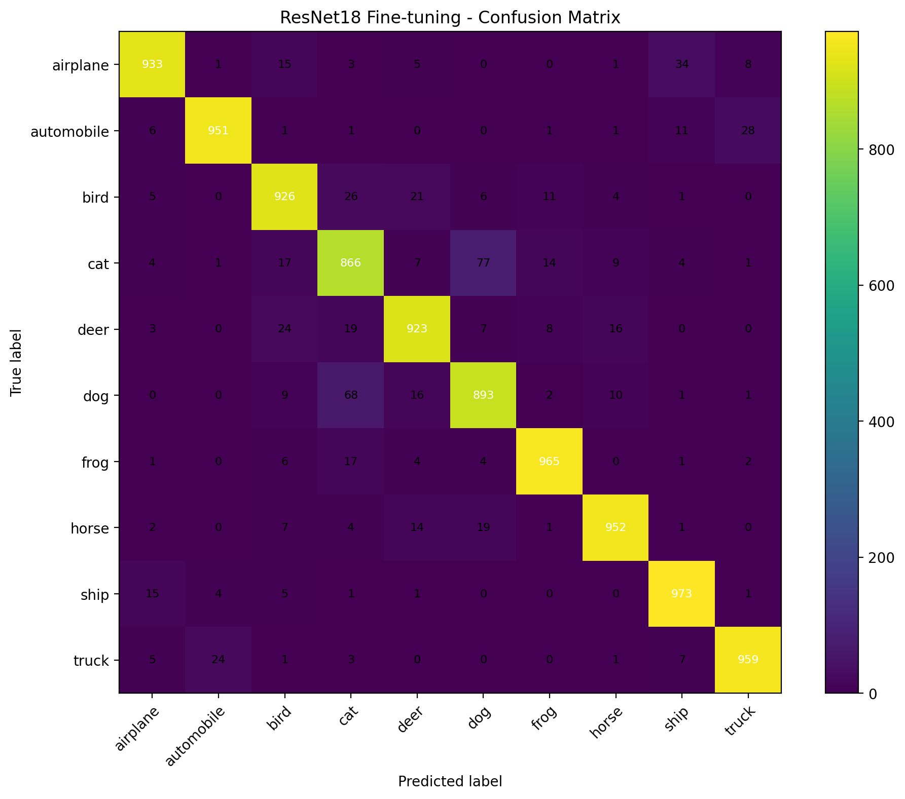

# CIFAR-10 Image Classification with PyTorch

A deep learning project exploring Convolutional Neural Networks (CNNs), data augmentation, transfer learning, and fine-tuning using PyTorch and the CIFAR-10 dataset.

The project compares custom CNN architectures with ResNet18 and evaluates their performance on a 10-class image classification task.

## Project Results

The best-performing model in the recorded experiments was **ResNet18 Fine-Tuning**, achieving **93.41% test accuracy** on CIFAR-10.

| Model | Test Accuracy |
|---|---:|
| SimpleCNN | 71.50% |
| SimpleCNN + Data Augmentation | 75.51% |
| ImprovedCNN + Data Augmentation | 82.54% |
| ImprovedCNN + Learning Rate Scheduler | 88.53% |
| ResNet18 Feature Extraction | 86.49% |
| **ResNet18 Fine-Tuning** | **93.41%** |

*These results come from the recorded experiments. Training configurations differ, so this table should be considered a comparison of experimental runs rather than a controlled benchmark.*

## Dataset

This project uses [CIFAR-10](https://www.cs.toronto.edu/~kriz/cifar.html), a dataset of 60,000 color images across 10 classes.

- 50,000 training images
- 10,000 test images
- Image dimensions: 32 × 32 pixels
- Number of classes: 10

**Classes:** airplane, automobile, bird, cat, deer, dog, frog, horse, ship, and truck.

The original training set was divided into 45,000 training images and 5,000 validation images.

The dataset is downloaded automatically by the training and evaluation data pipeline when needed.

## Methods

### 1. Custom CNN Architectures

Implemented and compared two custom convolutional neural networks: `SimpleCNN` and `ImprovedCNN`.

### 2. Data Augmentation

Applied random cropping and random horizontal flipping to training images to improve generalization.

### 3. Learning Rate Scheduling

Used `ReduceLROnPlateau` to reduce the learning rate when validation performance stopped improving.

### 4. Transfer Learning

Used pretrained ResNet18 weights and replaced its final classification layer with a layer for the 10 CIFAR-10 classes.

### 5. Fine-Tuning

Unfroze the ResNet18 `layer4` block and final fully connected layer. Separate learning rates were used for these layers.

### 6. Model Evaluation

Evaluated models using test accuracy, test loss, per-class precision, recall, F1-score, and confusion matrices.

## Final Model Evaluation

| Metric | Result |
|---|---:|
| Test Accuracy | 93.41% |
| Test Loss | 0.2343 |
| Test Images | 10,000 |

### Confusion Matrix



The model performs well across most classes. Cat and dog are among the more challenging classes, with misclassifications occurring in both directions.

The classification report provides additional per-class evaluation metrics.

## Interactive Prediction Demo

The project includes an interactive script that lets you select an image from your computer and view the model's top three predictions.

After obtaining the trained checkpoint, run:

```bash
python src/predict.py
```

The script opens a file-selection dialog and displays the top three predicted classes with their model scores.

**Note:** This demo is intended for images resembling the CIFAR-10 classes. Its results on arbitrary internet images may differ from its benchmark performance on the CIFAR-10 test set.

## Project Structure

```text
image-classification/
├── outputs/                 # Selected evaluation results and plots
├── src/
│   ├── dataset.py
│   ├── model.py
│   ├── predict.py
│   ├── train.py
│   ├── train_improved.py
│   ├── train_improved_v2.py
│   ├── train_resnet18.py
│   ├── train_resnet18_finetune.py
│   ├── evaluate.py
│   ├── evaluate_improved_v2.py
│   └── evaluate_resnet18_finetune.py
├── test/                    # Manual prediction images
├── tests/                   # Automated tests
│   └── test_model.py
├── data/                    # Downloaded dataset (not tracked)
├── models/                  # Model checkpoints (not tracked)
├── .gitignore
├── requirements.txt
└── README.md
```

The `data/` and `models/` directories are excluded from Git. The structure above highlights the main project files; additional helper scripts may also exist in `src/`.

## Installation

### 1. Clone the repository

```bash
git clone <YOUR_GITHUB_REPOSITORY_URL>
cd image-classification
```

Replace `<YOUR_GITHUB_REPOSITORY_URL>` with your repository URL.

### 2. Create a virtual environment

```bash
python -m venv .venv
```

Activate it on Windows PowerShell:

```powershell
.venv\Scripts\Activate.ps1
```

On macOS or Linux:

```bash
source .venv/bin/activate
```

### 3. Install dependencies

```bash
python -m pip install -r requirements.txt
```

## Running the Project

### Train the fine-tuned ResNet18 model

```bash
python src/train_resnet18_finetune.py
```

The training pipeline downloads CIFAR-10 when needed, trains the model, and saves the best checkpoint based on validation performance.

### Evaluate the trained model

```bash
python src/evaluate_resnet18_finetune.py
```

The evaluation script uses the trained checkpoint and generates a classification report, confusion matrix, and JSON summary under `outputs/`.

### Run interactive image prediction

```bash
python src/predict.py
```

Select an image in the file dialog to view the model's top three predictions.

**Checkpoint note:** Model checkpoint files are excluded from this repository because of their size. Train the model before running evaluation or prediction, or obtain a compatible checkpoint separately.

## Automated Tests

Run the automated tests with:

```bash
python -m pytest tests -v
```

The current tests check output shapes for the custom CNNs and ResNet18, verify that softmax probabilities sum to one, and check the expected number of CIFAR-10 classes.

These are primarily architecture and smoke tests; they do not independently validate the accuracy of the trained checkpoint.

## Technologies

- Python
- PyTorch
- Torchvision
- NumPy
- Matplotlib
- scikit-learn
- pandas
- pytest

## Key Learnings

- Building and training CNN architectures
- Applying data augmentation
- Monitoring validation performance
- Using learning rate schedulers
- Applying transfer learning and fine-tuning
- Evaluating classification models with multiple metrics
- Analyzing confusion matrices and classification errors
- Writing automated tests for machine learning code

## Future Improvements

- Compare additional architectures and optimizers under consistent training configurations
- Add more comprehensive automated tests
- Analyze misclassified images
- Improve per-class performance
- Explore object detection with architectures such as YOLO

## Author

Developed as a hands-on deep learning project to explore image classification, transfer learning, model evaluation, and PyTorch.